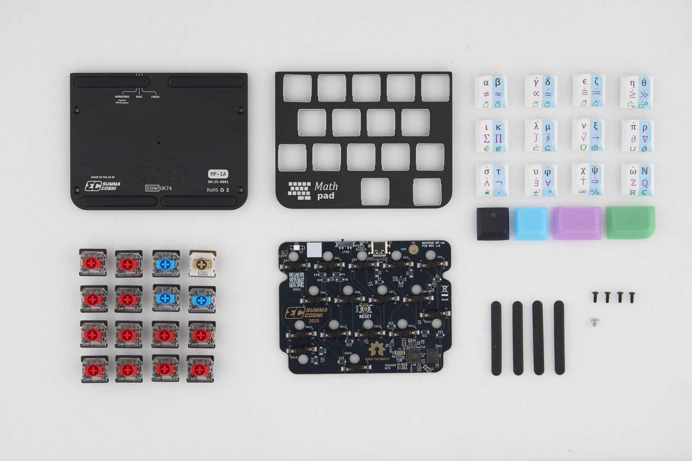
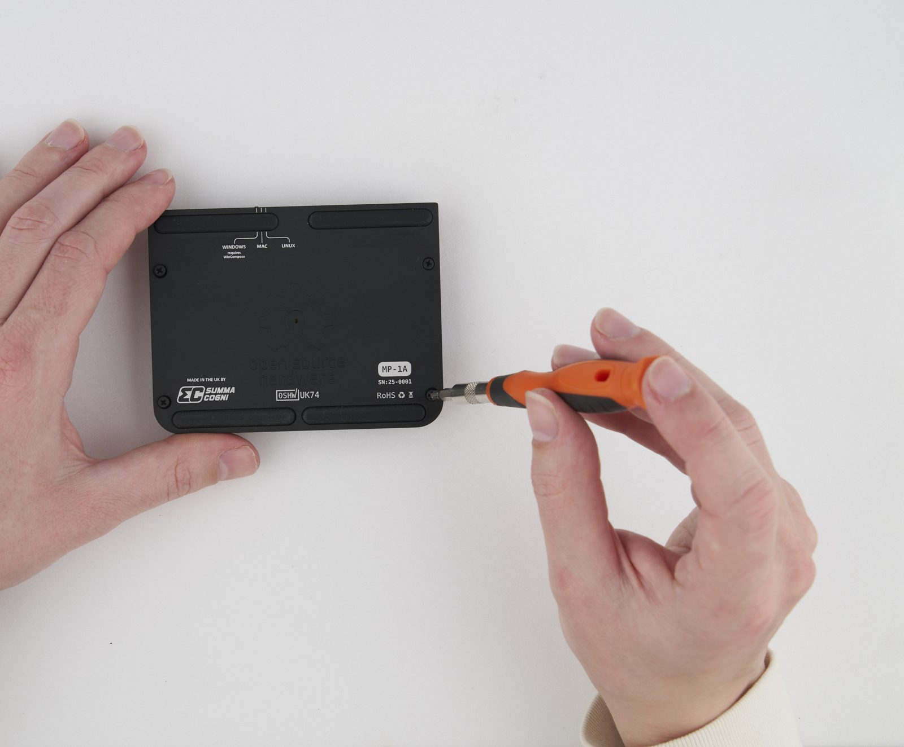
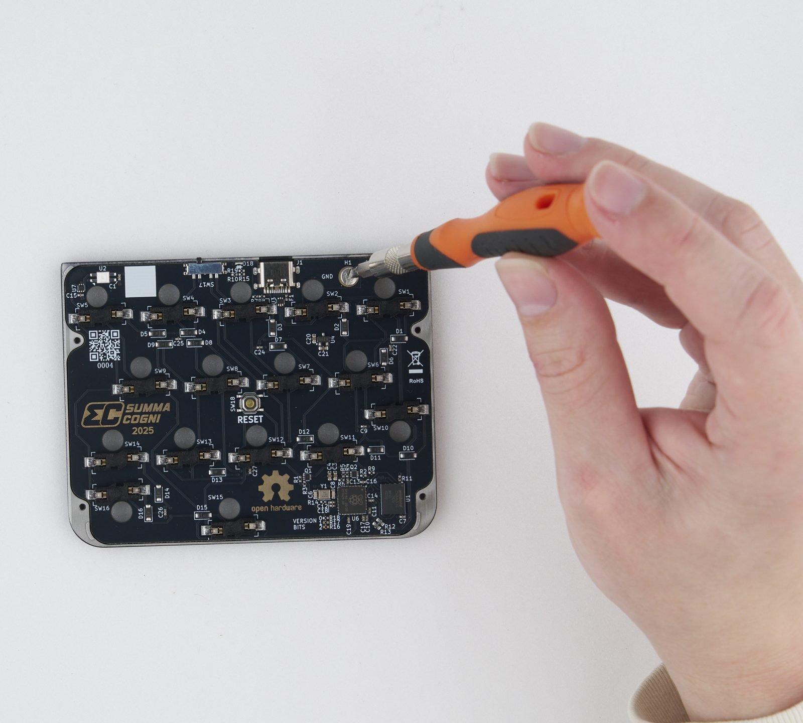
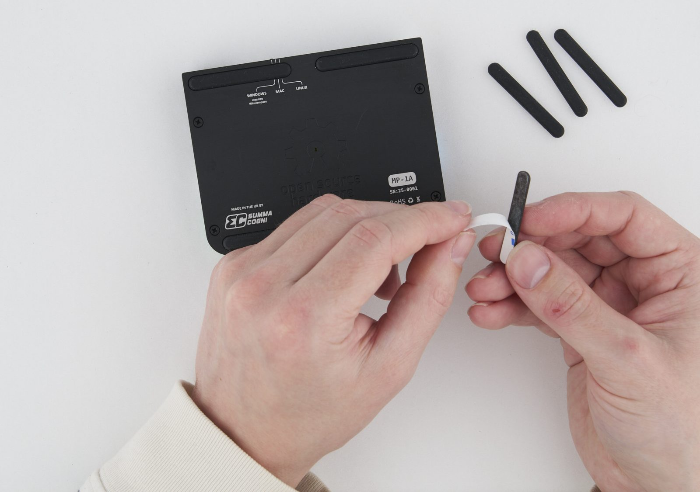
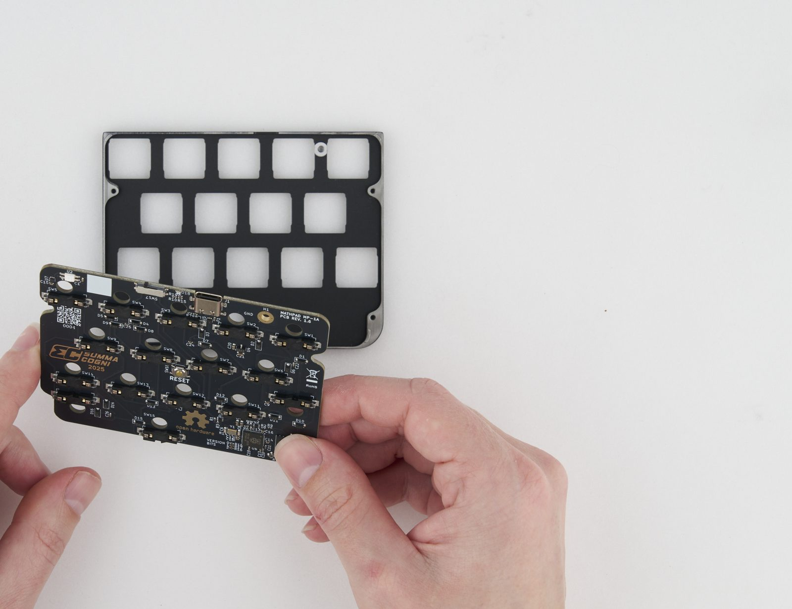
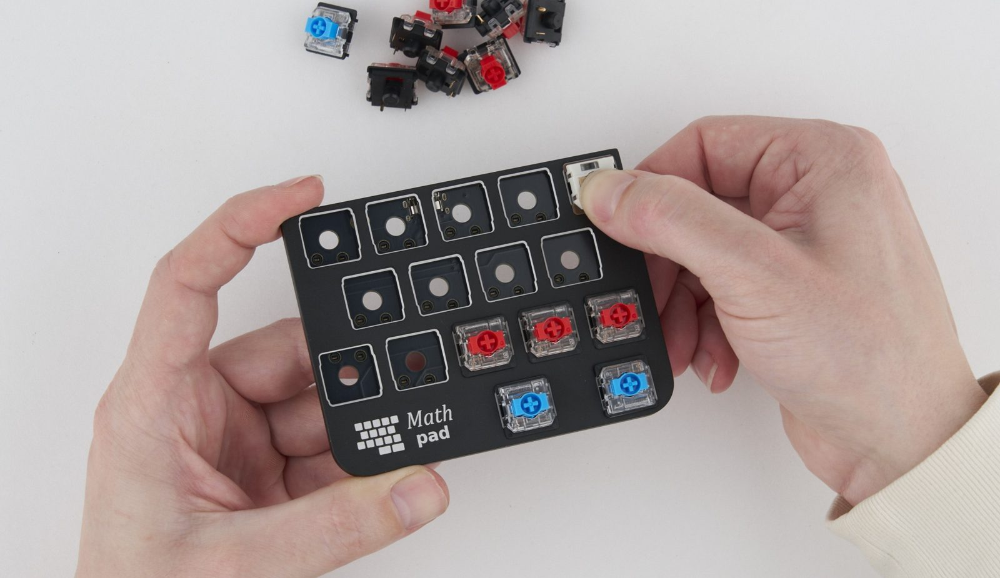
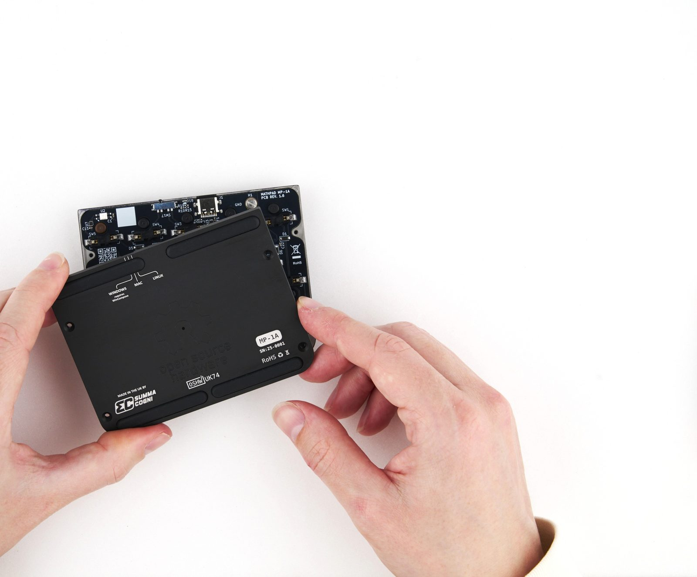
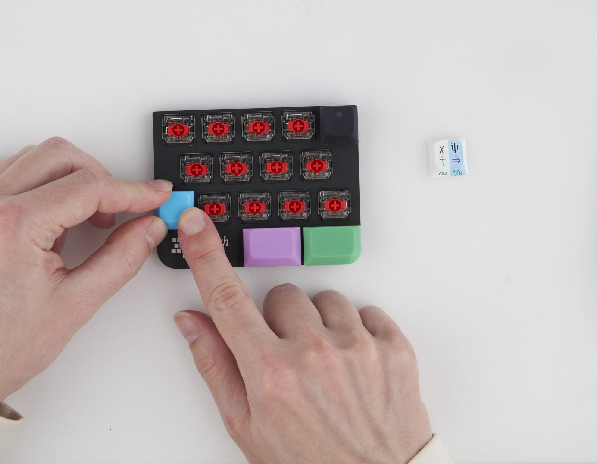

# Teardown and Repair

Mathpad is held together by screws and clips, not glue, so you can take it apart, clean it, and replace worn parts yourself. A full teardown takes about a minute.

You don't always need a full teardown:

- **To replace a switch**, you only need to open the case. The circuit board can stay in place. See [Replace a switch](#/teardown?id=replace-a-switch).
- **To replace the rubber feet**, you don't need to open anything. See [Replace the rubber feet](#/teardown?id=replace-the-rubber-feet).

## What you need

- A small Phillips screwdriver, for the four screws on the bottom
- A small flat screwdriver, for the ground screw inside
- Optionally, a keycap puller, sold by most keyboard shops. Fingers work too.

Unplug Mathpad before you start.

## The parts

Mathpad has an aluminum bottom plate and top plate, 16 keycaps, 16 Gateron KS-33 low-profile switches, a circuit board, four rubber feet, four Phillips screws for the case, and one small ground screw.

## Take it apart

### 1. Pull off the keycaps

Pull each keycap off, with your fingers or a keycap puller. Try to pull them straight up, or you may damage them.

### 2. Remove the four bottom screws

Turn Mathpad over and remove the four Phillips screws at the corners. The rubber feet don't cover them.

### 3. Lift off the bottom plate

Lift the bottom plate away. The circuit board stays attached to the top plate.

### 4. Pop out the switches

Each switch has a black cylindrical tab that sticks through the circuit board. From the inside, push on that tab with your finger, and the switch pops out through the front of the top plate. The switches are hot-swappable, so there is nothing to desolder.

### 5. Remove the ground screw

A small slotted screw next to the USB port, marked H1 and GND on the board, connects the circuit board to the top plate. Remove it with the flat screwdriver.

### 6. Lift out the circuit board

The circuit board now comes away from the top plate.

## Clean it after a spill

1. Unplug Mathpad straight away.
2. Take it apart as described above.
3. Wipe the aluminum plates and keycaps with a damp cloth.
4. Clean any sticky residue from the circuit board with isopropyl alcohol and a soft brush.
5. Let every part dry completely, ideally overnight, before you put it back together.

## Replace a switch

Switches are pushed out from inside the case, so you need to open it, but the circuit board can stay in place:

1. Follow steps 1 to 3 of [Take it apart](#/teardown?id=take-it-apart): remove the keycaps and the bottom plate.
2. From the inside, push the black tab of the switch you want to replace until it pops out through the front.
3. Push the new switch in from the front, through the top plate and into the board's socket, until it sits flush. Check that the pins go straight in.
4. Refit the bottom plate and its four screws, then press the keycaps back on.

Mathpad uses standard Gateron KS-33 low-profile switches, which many keyboard shops sell.

## Replace the rubber feet

The rubber feet are adhesive strips that sit in four channels on the bottom plate. Peel off the old ones, clean the channels with a solvent, then peel the backing off the new feet and press them in. They are standard SKUF feet, which many keyboard shops sell.

## Put it back together

Reassembly is nearly the same steps as teardown, but in reverse.

### 1. Fit the circuit board to the top plate

Place the circuit board on the back of the top plate, and fit the slotted ground screw beside the USB port.

### 2. Push in the switches

While supporting the circuit board with your fingers, push each switch in from the front, through the top plate and into the board's socket, until it sits flush. Check that its metal pins are straight before pushing them in, or they will bend and not enter 
the socket.

### 3. Fit the bottom plate

Fit the bottom plate and its four Phillips screws. Don't overtighten them, or the threads will strip.

### 4. Press on the keycaps

Press each keycap straight down onto its switch.

Plug Mathpad in and test a few keys with each modifier. If a key doesn't respond, pop it out and check if its metal pins got bent. Unbend them and re-seat the switch.

The full design files, including the circuit board and case drawings, are on [GitHub](https://github.com/Summa-Cogni/Mathpad). For anything not covered here, ask on the [Mathpad forum](https://www.summacogni.com/forum/viewforum.php?f=3).
